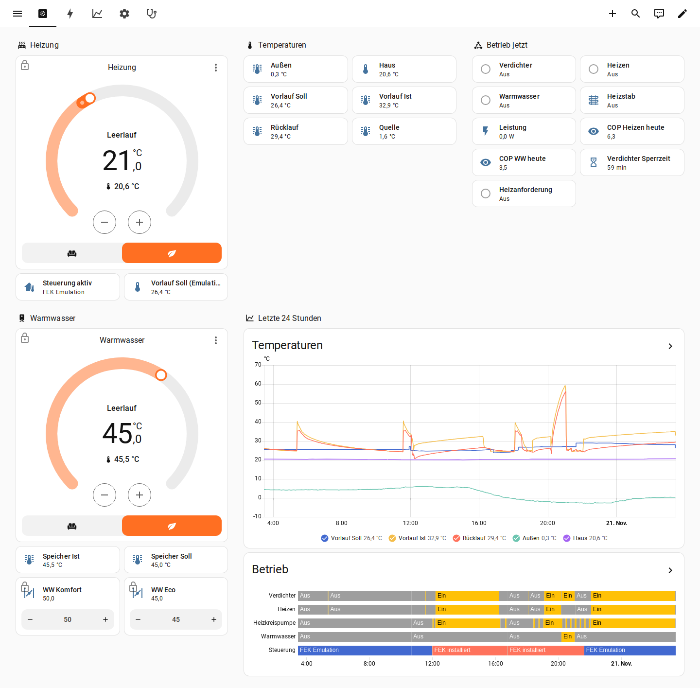
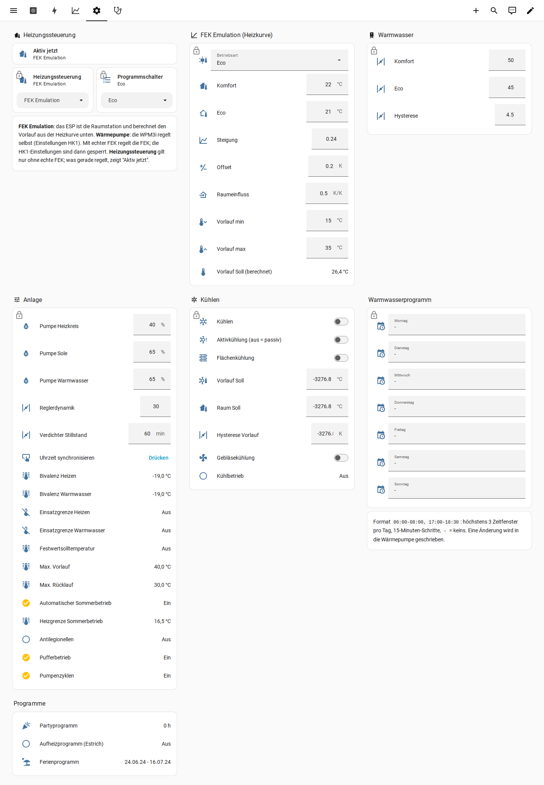

# Tecalor TTF07 C with WPM3i

This guide is for owners of a **Tecalor TTF07 C (cool) with the WPM3i heat pump manager**. The device file
[`yaml/ttf07_wpm3i.yaml`](../yaml/ttf07_wpm3i.yaml) supports it. Stiebel Eltron WPF models with a WPM3i may work
too, but nobody has tested them.

The plain [`yaml/ttf07.yaml`](../yaml/ttf07.yaml) is for a TTF07 without a WPM3i. Both build on
[`yaml/ttf07_base.yaml`](../yaml/ttf07_base.yaml). Entities that exist in both files keep their names, so you can
switch from `ttf07.yaml` to `ttf07_wpm3i.yaml` and keep their history in Home Assistant.



## What you get on top of `ttf07.yaml`

- Operating status and Programmschalter (operating mode) read from and written to the WPM3i, not the Kessel.
- Thermostats for heating and hot water, with presets Komfort and Eco.
- **Heating control** without a room station (FEK): the ESP can act as the FEK. See [below](#heating-control-and-fek-emulation).
- Power and energy split into heating, hot water and an external heating circuit pump, plus COP and operating hours.
- Cooling settings (the "Kühlen" menu) and the hot water time program.
- The fault list of the WPM3i.
- Two optional packages:
  - German display names: [`yaml/names/ttf07_wpm3i_de.yaml`](../yaml/names/ttf07_wpm3i_de.yaml).
  - Debug sensors for registers that are not identified yet: [`yaml/ttf07_wpm3i_debug.yaml`](../yaml/ttf07_wpm3i_debug.yaml).

## Installation

Follow the [installation guide](../README.md#installation-guide) in the README. In your device yaml, select the
TTF07 C package and set the substitutions:

```yaml
substitutions:
  # Room temperature and humidity from Home Assistant (used by the FEK emulation, see below)
  entity_room_temperature: "sensor.my_room_temperature"
  entity_humidity: "sensor.my_room_humidity"
  # Power of an external heating circuit pump in W (constant), 0 if you have none
  static_leistung_heizkreispumpe: "0"

packages:
  ttf07wpm3i: !include OneESP32ToRuleThemAll/yaml/ttf07_wpm3i.yaml
  # Optional: German display names. Choose before the first install (see below).
  # ttf07_names: !include OneESP32ToRuleThemAll/yaml/names/ttf07_wpm3i_de.yaml
  # Optional: sensors for registers that are not identified yet
  # ttf07_debug: !include OneESP32ToRuleThemAll/yaml/ttf07_wpm3i_debug.yaml
```

With the standard installation (`esp32-standalone.yaml`), add `yaml/ttf07_wpm3i.yaml` and the optional files to
the `files:` list of the package instead.

**Entity names:** without the names package, entities are named by their id (e.g. `HKISTTEMP`), like on the other
heat pumps. The names package gives them German names. ESPHome derives the Home Assistant entity from the name, so
switching the package later creates new entities and their history starts again.

The device does not need the option "Allow the device to perform Home Assistant actions": it only reads the room
values.

## Heating control and FEK emulation

On a TTF07 C, heating is controlled either by the WPM3i itself or by the FEK room station on heating circuit 1
(HK1). The select **"Heizungssteuerung"** chooses the mode when no FEK is installed. The sensor
**"Heizungssteuerung aktiv"** shows which mode runs:

| Heizungssteuerung aktiv | When | What happens |
|---|---|---|
| FEK installiert | a real FEK is connected | The FEK controls heating. The HK1 heating settings are locked here. |
| Wärmepumpe | no FEK, "Heizungssteuerung" = Wärmepumpe | The WPM3i controls heating with its own heating curve. The HK1 settings and the Programmschalter can be changed. |
| FEK Emulation | no FEK, "Heizungssteuerung" = FEK Emulation | The ESP acts as the FEK (see below). |
| Prüfung läuft | after a boot, until the FEK check has an answer | The HK1 settings are locked, normally for less than a minute. |

A locked setting refuses the change and shows the old value again.

### What the FEK emulation does

- The ESP registers as a FEK2 on HK1 and answers the WPM3i's presence check, which comes every 8 minutes.
- It sends the room temperature and humidity from Home Assistant every minute.
- It sends its own **flow setpoint** every 3 minutes, computed from its heating curve:

  `Vorlauf = Raumsoll + Steigung × (Raumsoll − Aussen) + Offset + Raumeinfluss × (Raumsoll − Raum)`

  Raumsoll is the Komfort or Eco temperature, selected by "FEK Emulation Betriebsart". An automation can switch it.
  The room influence term is limited to ±5 K. The result is limited to "Vorlauf min" … "Vorlauf max".

  The settings are the "FEK Emulation …" numbers in the device's configuration: Komfort, Eco, Steigung, Offset,
  Raumeinfluss, Vorlauf min, Vorlauf max.
- It **unlocks the "Kühlen" menu.** Without a FEK, the WPM3i hides the cooling settings.

### When the emulation stops or pauses

- **A real FEK appears:** the emulation stops at once and the FEK takes over.
- **No valid outdoor temperature:** no flow setpoint is sent.
- **"Heizungssteuerung" set to Wärmepumpe:** the WPM3i takes HK1 back within 8 minutes.
- **No valid room values from Home Assistant:** the emulation keeps running, but without the room influence. The
  room values are not sent, and the log shows a warning.
- **After a flash or reboot of the ESP:** the WPM3i keeps HK1 reserved for the old registration until its next
  presence check, so there is no emulation for up to 8 minutes. The compressor keeps running meanwhile. The
  emulation then registers again by itself, and the "Heizungssteuerung" selection is kept across reboots.



## Room temperature and humidity

Set `entity_room_temperature` and `entity_humidity` to Home Assistant sensors, for example an average over the
house. The ESP reads them through the ESPHome API.

Unlike the other heat pumps, this device file does **not** send these values to HK1 the way `core.yaml` does. Only
the FEK emulation sends them, like a real FEK.

The humidity is also what the heat pump uses for the dew point when cooling, so use a sensor that represents the
rooms being cooled.

## Hot water

**Speicher Soll** (the hot water setpoint) is **WW Komfort** only inside a time window of the hot water program
(Warmwasserprogramm). Outside a window it is **WW Eco**. The Programmschalter does not change this.

The select **"Warmwasser Modus"** and the hot water thermostat's presets work by writing the program:

- **Komfort** writes one window, 00:00–24:00, for all days.
- **Eco** clears all windows.

Switching the mode overwrites a program that was set on the control panel.

The texts "Warmwasserprogramm Montag" … "Sonntag" show the program and let you edit it. A day's windows are written
to the heat pump only when you change that day in Home Assistant.

## Energy dashboard

In Home Assistant's energy dashboard, add these as individual devices:

| Device | Energy | Power |
|---|---|---|
| Heat pump, total | Energie Summe | Leistung Summe |
| Hot water | EL_ENERGIEAUFNAHME_WW_SUMME_MWH | Leistung Warmwasserbereitung |
| Heating | EL_ENERGIEAUFNAHME_HEIZ_SUMME_MWH | Leistung Heizen |
| External heating circuit pump | Energie ext. Heizkreispumpe | Leistung ext. Heizkreispumpe |

The external pump's values come from `static_leistung_heizkreispumpe` while the pump runs.

## Dashboard example

[`doc/ttf07c/dashboard-example/ttf07_wpm3i_dashboard.yaml`](ttf07c/dashboard-example/ttf07_wpm3i_dashboard.yaml) is a complete Home
Assistant dashboard with five views: overview, energy, history, settings and diagnostics. To use it:

1. Go to Settings > Dashboards > Add dashboard > "New dashboard from scratch".
2. Open it, then Edit dashboard > Raw configuration editor. Paste the file and save.

The comment at the top of the file explains its assumptions:
- The entity ids assume the device's friendly name "Wärmepumpe" and the German names package.
- Replace `sensor.HOUSE_TEMPERATURE` with your own sensor.

More screenshots: [`ttf07c/images/`](ttf07c/images/).

## Known limitations

- **Cooling:** the settings are mapped, but cooling itself is not tested yet. "Betriebsstunden Kühlen" stays empty
  until the heat pump has cooled.
- **Debug sensors:** some registers that are always on the bus are not identified yet. The debug package shows them
  by address. Their names and meaning may change.
- **Fault list:** the WPM3i's fault list is read once a day. Single date fields can be missing (`??`) when frames of
  the answer are lost.
